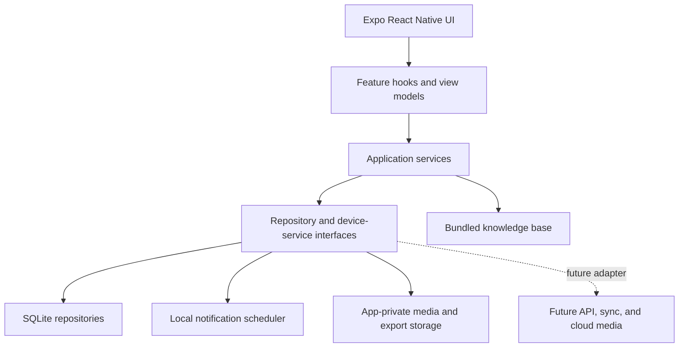
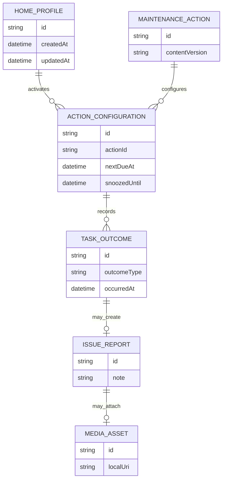
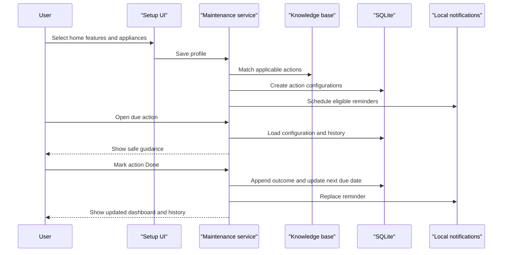
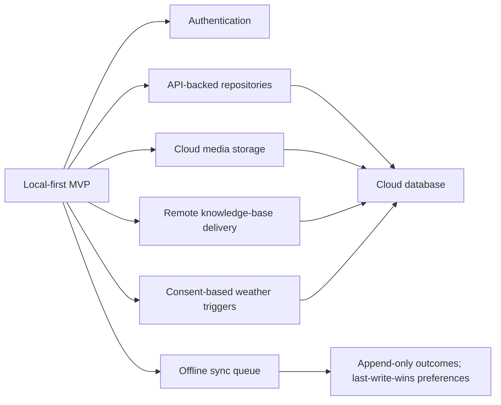

# House Care — Consolidated Implementation Plan

**Status:** Approved direction, ready to begin Delivery 0/1  
**Product:** Local-first cross-platform mobile app for routine home-maintenance guidance  
**Primary languages:** English first; Danish before the pilot  
**Initial audience:** First-time owners of Danish detached or terraced homes

## 1. Product decisions

House Care helps a homeowner take a small, safe maintenance action at the right time:

```text
Home profile → applicable action → safe guidance → outcome → next due date/history
```

The MVP is deliberately local-first:

- iOS and Android phones only.
- No authentication, backend, cloud sync, or required network connection.
- Bundled maintenance guidance, local SQLite persistence, and scheduled local notifications.
- English is the first implementation language; Danish is added before the pilot.
- The app does not diagnose faults, prescribe technical repairs, recommend contractors, or show advertising/affiliate links.

### Confirmed behaviour

- One primary due action and up to two upcoming actions appear on Home.
- Opening an action from the Actions tab returns to that tab when the user uses the detail back control; Home and Actions overview retain their own return destinations.
- The user can mark an action Done, Snooze, or I noticed an issue; actions can also be disabled temporarily.
- A user can override any default frequency, reset it, or disable the action.
- Notifications are local-device notifications, defaulting to 09:00 in the device timezone.
- Snooze choices are Tomorrow, In one week, and Choose a date. Custom snooze uses a native date picker and stores the selected date at 09:00 device-local time as UTC.
- One photo may be attached to an issue; it remains in app-private local storage.
- Export/import uses a versioned local format. No data leaves the device automatically.
- Settings includes an offline About & legal area with installed version/build details, Privacy Policy, Terms of Use & Safety, acknowledgements, and Data & permissions. Matching canonical legal pages are published separately from the private app source; legal identity and contact placeholders must be replaced before public release.
- On first launch, Danish is selected only when the device system language is Danish; every other system language defaults to English. A language selected in Settings is persisted and takes precedence over later system-language changes.
- First-launch setup is a guided three-step flow: home type and age, appliances (including applicable appliance types), then home features and a preview of the resulting maintenance plan. Settings uses a separate compact home-profile editor with the same fields and no onboarding progress or plan preview.
- Profile and notification settings use local drafts when opened from Settings. Their changes are validated and committed, including action recalculation and notification rescheduling, only when the user leaves with the visible Back control or a deliberate left-edge swipe.
- Secondary screens support deliberate left-edge swipe-back navigation. Primary tabs do not respond to swipe-back gestures.

### Deliberate refinements

- **Postcode is optional and deferred from the first setup flow.** With no weather service or cloud feature, it has no essential MVP use. Add it only when a specific, consented local or weather-based use case exists.
- **After-every-cycle care is a habit card, not a scheduled reminder.** The app cannot know appliance-cycle counts offline. The tumble-dryer lint-filter action is shown in the action catalogue and after-use education, but is not scheduled until a future usage-tracking feature exists.
- **Long or higher-risk activities are split or inspection-only.** The user must never be instructed to climb onto a roof, enter a well, open electrical covers, alter heat-pump/manifold settings, or dismantle fixed installations.

## 2. Technical architecture

### Chosen stack

- Expo React Native with TypeScript.
- Expo Router for navigation.
- React Native core components and a small design-system layer.
- `expo-sqlite` for durable structured data.
- `expo-file-system` for app-private issue photos and export files.
- `expo-print` and `expo-sharing` for one-way, user-initiated PDF maintenance report export.
- `expo-application` for installed app version and native build-number display.
- `expo-notifications` for local scheduled reminders.
- `react-i18next`/i18next for UI and knowledge-base localization.
- Zod for runtime validation of knowledge-base content and imported data.
- Jest + `jest-expo` + React Native Testing Library for unit/component tests.
- Maestro for critical end-to-end flows.

Expo SQLite persists data across app restarts and Expo Notifications supports local scheduled notifications, which directly suits the offline product design. See [Expo storage guidance](https://docs.expo.dev/develop/user-interface/store-data/) and [Expo notifications guidance](https://docs.expo.dev/push-notifications/what-you-need-to-know/).

### Architecture style

Use a **feature-first modular monolith** with clean dependency boundaries. This is simpler than microservices or a full domain framework, while preserving an API/cloud path later.

Expo Router owns application navigation. Primary destinations are file-based tab routes; action details, issue flows, settings subflows, reports, and legal documents use explicit routes and route parameters for identifiers and return destinations.

Application workflows depend on repository and device-service interfaces. SQLite, local notifications, device time, and ID generation are production adapters; `recordOutcome` is the first migrated workflow and is tested with injected ports.

Multi-record workflow changes commit inside an exclusive SQLite transaction. Notification scheduling is reconciled only after that durable commit and on app reload or foreground recovery, so a transient device-service failure never rolls back a completed maintenance action.

```text
Screens and components
        ↓
Feature view models / hooks
        ↓
Application services (business rules)
        ↓
Repository interfaces + device-service interfaces
        ↓
SQLite, file system, notifications, future HTTP API
```

Rules:

- Screens do not query SQLite, schedule notifications, or calculate due dates directly.
- Application services depend on interfaces, not Expo or SQLite APIs.
- SQLite and Expo adapters implement those interfaces.
- Domain types do not import React, Expo, SQLite, HTTP, or platform APIs.
- The app uses composition at startup to select local implementations. A future cloud implementation can compose API-backed repositories and a sync engine without rewriting the UI or business rules.



### Proposed project layout

```text
app/                         Expo Router routes and layouts only
src/
  features/                  Home, onboarding, actions, history, settings
  domain/                    Types, date rules, eligibility, pure functions
  application/               Use-case services and repository contracts
  infrastructure/
    database/                SQLite schema, migrations, repositories
    notifications/           Local notification adapter
    files/                   Photo/export adapter
    i18n/                    Translation configuration
  design-system/             Tokens and reusable native components
  knowledge-base/            Validated bundled content loader
  test-support/              Fixtures, fakes, factories
knowledge-base/              Versioned source content and validation scripts
__tests__/                   Router/component integration tests
maestro/                     End-to-end flow definitions
```

### State management

- SQLite is the source of truth for durable user data.
- Feature hooks/services load, mutate, and refresh durable state.
- Use a small client store only for transient UI state: active filters, open dialogs, and in-progress form state.
- Do not introduce a server-cache library until a real API exists.

### Composition and dependency contracts

The application startup code composes local implementations of these interfaces and exposes them to feature services:

- `HomeRepository`
- `ActionConfigurationRepository`
- `OutcomeRepository`
- `IssueRepository`
- `SettingsRepository`
- `NotificationScheduler`
- `MediaStore`
- `ExportService`

The UI must invoke use-case services rather than these interfaces directly. Services own all cross-record operations, including setup completion, action completion, issue reporting, import, reset, and notification rescheduling. All contracts are asynchronous so API-backed implementations can later replace or compose with local adapters.

## 3. Domain and persistence design

### Core domain records

| Record | Purpose | Cloud-ready fields |
|---|---|---|
| `HomeProfile` | Selected house systems and appliances | `id`, `createdAt`, `updatedAt`, `deletedAt` |
| `MaintenanceAction` | Immutable bundled guidance record | stable `id`, `contentVersion` |
| `ActionConfiguration` | User enablement, override, and next due date | `id`, `actionId`, timestamps |
| `TaskOutcome` | Append-only Done, Snooze, or Issue outcome | `id`, `actionId`, `occurredAt` |
| `IssueReport` | Note, local media asset, and safe follow-up | `id`, `taskOutcomeId`, timestamps |
| `MediaAsset` | App-private file reference and metadata | `id`, `localUri`, timestamps |
| `AppSettings` | Language, notification time, consent/preferences | `id`, `updatedAt` |

All user-owned records use UUIDs and UTC ISO-8601 timestamps. Soft deletion is reserved for syncable user data; the UI treats deleted records as absent. History remains append-only except for an explicit user delete/reset action.



### Scheduling model

```ts
type FrequencyUnit = "day" | "week" | "month" | "year";

type Trigger =
  | { kind: "recurring"; defaultFrequency: Frequency }
  | { kind: "seasonal"; seasons: Season[]; defaultFrequency?: Frequency }
  | { kind: "habit"; presentation: "after-use" | "manual-check" }
  | { kind: "future-weather"; weatherEvents: WeatherEvent[] };
```

- A user override supersedes a knowledge-base default.
- Monthly reminders use the same calendar day where possible, otherwise the final valid day of the month.
- A frequency change recalculates future due dates immediately; it never changes history.
- Snooze changes only the current due date.
- `habit` actions never create device notifications in the MVP.
- Seasonal/weather metadata is retained in content now, but automated weather triggers are not implemented.



### SQLite responsibilities

SQLite stores only user-specific data. The bundled knowledge base remains read-only and is loaded by stable action ID.

- Create tables for `home_profiles`, `home_features`, `appliances`, `appliance_variants`, `action_configurations`, `task_outcomes`, `issue_reports`, `media_assets`, `app_settings`, `event_log`, and `schema_migrations`.
- Create schema migrations before any feature table is introduced.
- Use parameterized prepared statements.
- Keep SQL inside infrastructure repositories.
- Test every migration from the immediately previous schema version and from a fresh install.
- Validate import JSON before any transaction writes data.

### Initial scheduling policy

- Add `initialPriority` and `initialDueOffsetDays` to every schedulable knowledge-base action.
- On setup completion, create configurations only for eligible actions.
- Schedule no more than one recurring action for today; stagger later recurring tasks by the content-defined offset.
- Schedule seasonal tasks for the next applicable seasonal window.
- Replace the existing tumble-dryer `cycle` frequency unit with `trigger.kind: "habit"` and `presentation: "after-use"`; it is visible in the catalogue but does not schedule a notification.
- Store `nextDueAt` and `snoozedUntil` in `ActionConfiguration`; a user frequency override is stored separately from the knowledge-base default.

### Privacy and device storage

- Store data and photos only in app-private storage.
- Request camera/photo permission only when the user selects Add photo.
- Copy a selected photo into the app directory and remove EXIF/location metadata before persisting it.
- Do not log free-text issue notes, file paths, or user-entered data.
- Export is user initiated and clearly labelled as a local file.
- Reset deletes the database and app-owned photos only after confirmation.
- Do not write private data to public/shared storage or include it in analytics.

This follows data-minimization and private-storage principles described by [OWASP Mobile Application Security](https://cheatsheetseries.owasp.org/cheatsheets/Mobile_Application_Security_Cheat_Sheet.html).

## 4. Knowledge base and localization

The current English-canonical catalogue is [maintenance-actions-v0.1.json](knowledge-base/maintenance-actions-v0.1.json). It contains 21 atomic actions with stable IDs, eligibility conditions, default scheduling, safety level, guidance, escalation text, sources, and Danish translations.

### Content contract

Every action must have:

- Stable ID and category.
- Profile conditions.
- Trigger and one deterministic default frequency where it is schedulable.
- Estimated duration and safety level.
- Why it matters, safe steps, normal signs, concerning signs, escalation guidance, restrictions, and manual note.
- English canonical text and a Danish translation with equivalent safety meaning before pilot release.
- Source URLs, content version, and review date.

### Content governance

- Manufacturer/installer guidance overrides generic app text.
- Content updates cannot overwrite user frequency overrides or history.
- Review source links and all higher-risk entries at least annually.
- Before pilot, obtain trade/manufacturer review for washing-machine pump filters, dryer condenser care, gutter access, faskine/pump-well actions, ventilation filter access, underfloor heating, and wood-floor treatment.
- Show source/manual information on a secondary detail section; keep the primary task focused on a safe next action.

### Localization flow

1. Put all UI strings behind translation keys from Delivery 1.
2. Keep the English knowledge-base content canonical while feature work is built.
3. Add `content.da` for every action in the localization delivery.
4. Add English/Danish language selection in Settings; default to English.
5. Test both languages for safety equivalence, layout, screen-reader labels, and notification text.

## 5. UI design specification

The visual direction is calm, practical, and reassuring:

- Warm off-white background.
- Deep forest green primary actions.
- Sage selected/informational states.
- Yellow “Why this matters” callout.
- Red safety-escalation treatment.
- Large, friendly typography, clear spacing, and one primary action at a time.

### Screens

| Screen | Primary outcome |
|---|---|
| Setup | Select home systems and appliances in under three minutes. |
| Home | See one due action and up to two upcoming actions. |
| Actions | Browse active applicable actions by category. |
| Action detail | Read safe guidance, record an outcome, or add the current scheduled occurrence to a personal calendar. |
| Frequency editor | Set, reset, or disable a personal schedule. |
| Issue report | Add optional note/photo and receive safe next steps. |
| History | Review completed tasks and issue records. |
| Settings | Profile, actions overview, language, notification settings, data-export, and reset controls. |
| Actions overview | Browse all catalogue actions by category and status; open applicable enabled or disabled actions in detail. |

### Accessibility baseline

- Dynamic text support.
- Semantic screen-reader labels and live feedback after outcomes.
- Minimum 44 × 44 point touch targets.
- Sufficient contrast; colour is never the only state indicator.
- Logical focus/keyboard handling in forms.
- Layout validation at the smallest supported phone width in English and Danish.

### Required workflow and error states

- Setup validates required profile choices before save; editing a profile updates applicable configurations without deleting outcomes or issues.
- The Home screen ranks due actions by overdue status, content priority, then due date; it shows one primary task and two upcoming tasks.
- Done appends an outcome, clears snooze state, calculates the next due date, and replaces the local notification.
- Snooze changes only `snoozedUntil` and reschedules the existing action; it does not alter frequency.
- Add to calendar creates a one-time event in a user-selected writable device calendar using the current due or snooze time. It is a snapshot: later House Care changes never update or delete the calendar event.
- Disable action pauses the configuration without recording a history outcome. Re-enabling is available in Settings.
- Issue reporting accepts no attachment, note only, image only, or both. It always renders the action’s stored escalation guidance and never adds diagnostic content.
- Database initialization, import, media copy, and notification failures produce a clear retry-safe UI state. Import failure must leave all existing data untouched.

## 6. Delivery plan

Each delivery ends with a build that can be manually tested. No delivery is complete until its automated tests and its listed UI checks pass.

### Delivery 0 — Repository and product setup

Create the Expo project, initialize Git, add development/preview/production configuration, establish code style, CI basics, and issue/decision tracking.

**Exit:** A clean app shell builds locally and the team can run type-check, lint, and tests.

### Delivery 1 — Foundation, boundaries, and English i18n

Implement the project layout, design tokens, Expo Router shell, i18n setup with English default, domain types, repository interfaces, SQLite bootstrap, migration runner, and test support.

**Unit:** UUID/timestamp utilities, migration runner, repository contract fakes.  
**UI:** Offline app launch; Home, Actions, History, and Settings navigation; empty states.  
**Exit:** Screens do not import SQLite/Expo infrastructure directly.

### Delivery 2 — Knowledge base and maintenance rules

Add a Zod-validated loader for the 21-action knowledge base. Implement eligibility, due-date calculation, seasonal metadata, frequency rules, and habit-action treatment.

**Unit:** Content schema, duplicate IDs, missing safety fields, eligibility, calendar edge cases, user override precedence, habit actions excluded from notification scheduling.  
**UI:** Applicable actions display after a profile exists; irrelevant actions do not.  
**Exit:** Knowledge-base validation runs in CI and fails safely on invalid content.

### Delivery 3 — App shell and design system

Build the shared mobile UI: bottom tabs, action cards, callouts, buttons, setting rows, input controls, loading/empty/error states, and accessibility primitives.

**Unit:** Component state and accessibility-label helpers.  
**UI:** Navigation, small-screen layout, selected states, offline status, and accessible touch targets.  
**Exit:** All primary screens use the shared design system.

### Delivery 4 — Home setup and profile editing

Implement first-run setup for house type, age band, features, appliances, and optional brand/model. Defer postcode until it has an approved use. Support later editing without erasing history.

**Unit:** Profile validation, persistence, action-configuration generation, idempotent updates.  
**UI:** Complete setup under three minutes, toggle options, validation, restart persistence, edit profile.  
**Exit:** A profile produces only relevant active action configurations.

### Delivery 5 — Home dashboard and action discovery

Implement the primary due action, two upcoming actions, full action list, category browsing, and no-action state.

**Unit:** Dashboard ranking, one-primary/two-upcoming cap, due/upcoming ordering, disabled and snoozed filtering.
**UI:** View current/upcoming actions and open detail.  
**Exit:** The Home screen matches the approved UI direction.

### Delivery 6 — Safe action detail and outcome loop

Implement safe action detail, Done, Snooze, Disable action, and issue-start flows. Persist outcomes and recalculate the next due date where appropriate.

**Unit:** Outcome transitions, append-only history, next-date calculation, snooze, disable rules, escalation-content guards.
**UI:** Complete every outcome from a real action and observe Home/History updates.  
**Exit:** Setup → action → outcome → history works offline.

### Delivery 7 — Frequency customization

Implement presets (weekly, monthly, quarterly, twice yearly, yearly), validated custom intervals, reset-to-default, disable action, and date preview.

**Unit:** Invalid interval rejection, override precedence, calendar calculation, reset behaviour, duplicate prevention.  
**UI:** Change, save, view, reset, and disable an action frequency.  
**Exit:** User scheduling preferences survive restart and do not alter history.

### Delivery 8 — Local notifications

Implement permission education, global/per-action settings, schedule/cancel/reschedule logic, notification response routing, and denied-permission handling.

**Unit:** Scheduler adapter contract; schedule recalculation after complete/snooze/disable/profile/frequency changes; duplicate prevention.  
**UI/device:** Permission handling, preference controls, notification opens the right action, app remains usable without permission.  
**Exit:** Local reminders work on physical iOS and Android devices; no backend is involved.

### Delivery 9 — Issue records and history

Implement optional note/photo capture, media copying and metadata stripping, safe next-step screen, history browsing, filters, and individual record deletion.

**Unit:** Media asset lifecycle, issue/history repositories, deletion cleanup, filters.  
**UI/device:** Report an issue with no attachment, note only, photo only, or both; view/delete records.  
**Exit:** No issue path gives a diagnosis or unsafe repair instruction.

### Delivery 10 — Data management and Danish localization

Implement versioned export/import, transactional import validation, reset flow, English/Danish setting, Danish UI strings, and Danish knowledge-base translations.

**Unit:** Export/import round trip, schema-version validation, no partial writes on failure, locale selection.  
**UI:** Export/import feedback, confirmed reset, language switch, bilingual text/layout.  
**Exit:** All 21 actions have reviewed English and Danish content; import/export preserves profile, overrides, history, and issue metadata.

### Delivery 11 — Pilot hardening and distribution

Run accessibility, content-safety, data-migration, offline, upgrade, and device tests. Create preview builds for iOS and Android and prepare the pilot feedback process.

**Unit:** Full regression suite, migration paths, timezone/DST cases, content validation.  
**UI/device:** Critical journeys on physical iOS and Android devices; force-close/restart; update install; notification and photo permissions.  
**Exit:** Pilot release candidate meets every release gate below.

### Detailed implementation specification

#### Delivery 0–2: engineering baseline

- Define TypeScript domain types before writing screens or database adapters.
- Add Zod schemas for knowledge-base content and versioned import manifests; validate knowledge-base records in CI.
- Add an in-memory implementation of every repository/device-service interface for deterministic unit tests.
- Establish a composition root that selects SQLite, local-file, and local-notification implementations at startup.
- Put all English UI strings behind translation keys immediately; do not add hard-coded screen copy.

#### Delivery 3–5: profile and action discovery

- Capture house type, age band, selected features, selected appliances, and appliance variants during setup.
- Appliance variants are `vented`, `condenser_or_heat_pump`, or `unknown` for dryers, and `ducted`, `recirculating`, or `unknown` for cooker hoods. Variant-specific tasks remain hidden when unknown.
- Defer postcode from the MVP setup because no offline feature uses it.
- Keep app screens thin: each screen calls a feature hook/view model, which invokes a use-case service and renders its result.

#### Delivery 6–9: local action loop

- Implement outcomes as a finite state transition in one service, not separately in each screen.
- Use the system photo picker only; direct camera capture is deferred to reduce permissions and test scope.
- Copy selected images into app-private storage, remove metadata before persistence, and allow exactly one media asset per issue.
- Schedule reminders once at 09:00 device-local time on `nextDueAt`; do not create repeated overdue notifications.
- Recalculate notification schedules after profile edits, completion, snooze, frequency changes, disablement, re-enablement, and app import.

#### Delivery 10–11: backup, language, and release quality

- Export a versioned ZIP archive containing `manifest.json`, structured user data, and copied issue images.
- Keep the local backup import/export controls development-build-only; the user-facing report export remains available in production builds.
- From the compact History report-export screen, export a one-way PDF maintenance report for a selected period. Reports include completed work, issue notes, and available issue photos; they use the active app language and are shared through the device without changing House Care data.
- Validate all archive data before one transactional import; malformed or unsupported exports must not partially write the database.
- Add English/Danish selection in Settings and complete Danish translations for UI, including all user-visible Home, action, profile, Settings, and notification text; Home Profile headings and every home, appliance-type, and feature option; knowledge-base text; notification copy; and accessibility labels.
- Test both languages for visual overflow and equivalent safety meaning before pilot release.

## 7. Test strategy

### Test pyramid

- **Unit tests:** Pure domain rules, services, validation, migrations, repository behaviour, and notification/file adapter contracts.
- **Component/integration tests:** User-visible screen states, form validation, accessibility, and Expo Router navigation using React Native Testing Library.
- **End-to-end tests:** Critical journeys in Maestro on simulator/emulator and a final physical-device pass.
- **Manual checks:** Visual layout, translations, notification timing, permissions, and app upgrade behaviour.

Expo currently recommends Jest with `jest-expo`, React Native Testing Library, and end-to-end tests for UI behaviour rather than relying on snapshots. See [Expo’s unit-testing guidance](https://docs.expo.dev/develop/unit-testing/).

### Required end-to-end journeys

1. Fresh install → setup → relevant action appears.
2. Open an action → Done → next due date → History entry.
3. Change frequency → restart → frequency persists → completion uses override.
4. Snooze action → dashboard updates → reminder reschedules.
5. Disable action → action disappears → later re-enable works.
6. Issue report with note/photo → safe next step → history → deletion cleans up photo.
7. Notification permission granted/denied → app remains correct in both states.
8. Export → reset → import → profile, history, and overrides restore.
9. Switch English/Danish → content, navigation, and notifications display correctly.
10. Offline → force-close → restart → data remains intact.

### Quality gates

Every pull request runs:

```text
type-check → lint → knowledge-base validation → unit/component tests → build smoke test
```

Before preview/pilot builds, additionally run:

```text
Maestro critical flows → migration tests → manual iOS/Android device checks → accessibility review
```

## 8. Pilot measurement and release flow

### Local event log

Do not add third-party analytics to the MVP. Store a minimal local event log, included only in explicit export:

- setup started/completed
- action shown/opened
- done/snooze/issue outcome
- frequency changed
- return visit

Do not log notes, photos, postcode, or other user-entered content.

### Pilot measures

- Profile completion: at least 60% of invited users.
- Preventative action: at least 40% complete one task they say they would otherwise have missed.
- Repeat engagement: at least half of activated users return after their first alert.
- Issue signal: count and category only; no self-diagnosis prompt.

### Distribution

- Use development builds for engineering.
- Use EAS internal distribution/preview builds for stakeholder and pilot testing.
- Use TestFlight and Google Play internal testing when those tracks are preferred for pilot logistics.
- Configure separate `development`, `preview`, and `production` build profiles.

Expo recommends preview/internal-distribution builds for sharing reviewable native apps; Expo Go is not intended as the production-grade review path. See [Expo review distribution](https://docs.expo.dev/review/overview/) and [internal distribution](https://docs.expo.dev/build/internal-distribution/).

## 9. Future cloud path — explicitly deferred

Do not build authentication, APIs, sync, remote content updates, or push notifications in the MVP. Preserve the option by keeping repository contracts, stable record IDs, timestamps, soft deletes, versioned exports, and file abstractions.

When cloud work is justified, add:

1. Account/authentication layer.
2. API-backed repository implementations.
3. Sync queue with retry and connectivity awareness.
4. Conflict policy: append-only outcomes merge naturally; user configuration uses last-write-wins initially.
5. Separate media upload/sync from structured-record sync.
6. Remote knowledge-base delivery with explicit content-version migration.
7. Server-triggered weather notifications only after consent and a verified weather data source.



## 10. Release gates

### Alpha

- Deliveries 1–4 complete.
- Offline setup works.
- Relevant action configuration persists after restart.

### Internal beta

- Deliveries 5–8 complete.
- Core action loop, frequency overrides, and local notifications pass on both platforms.

### Pilot release candidate

- Deliveries 9–11 complete.
- English and Danish reviewed.
- Source/manual and higher-risk content review complete.
- Export/import and database upgrade tests pass.
- Critical journeys pass on physical iOS and Android devices.
- No unresolved high-severity safety, data-loss, or accessibility defects.

## 11. Explicitly out of scope

- Authentication, backend, cloud sync, or push notifications.
- Weather APIs and automated weather-triggered alerts.
- OCR, document upload, manual extraction, BBR/Boligejer/insurance integrations.
- AI diagnosis/chat, contractor marketplace, quotes, payments, advertising, affiliates, or sponsorship.
- Native tablet/desktop/web support.
- Automatic appliance-usage tracking.

## 12. Assumptions and defaults

- Expo React Native, TypeScript, Expo Router, SQLite, and local notifications are the approved MVP stack.
- The MVP supports iOS and Android phones only; tablet, desktop, web, and native platform-specific feature work are excluded.
- One home profile is supported per installation; multiple-home management is deferred.
- English is the default language during early delivery; Danish is available before the pilot through the same translation keys and action IDs.
- The app is fully usable offline. No authentication, backend, cloud sync, API, weather integration, remote content update, or push notification is included.
- Postcode is not collected in the MVP because it has no approved offline use; it may be added later with explicit purpose and consent.
- Local reminders occur once at 09:00 device-local time on the due date. No repeated overdue reminders are sent.
- Notification settings combine the local-notifications switch and weekly timing. Timing is ordered Monday through Sunday and is unavailable while local notifications are off.
- Monthly schedules use the same calendar day where possible, otherwise the final valid day of the month.
- User frequency changes apply immediately to future scheduling, never rewrite history, and can be reset to the bundled default.
- Snooze options are tomorrow, one week, or a chosen date; snooze does not alter the recurring frequency.
- Disable action pauses an action until manually re-enabled in Settings.
- Settings provides an Actions overview grouped by catalogue category. It shows enabled, disabled, and not-applicable status; enablement changes happen in action detail and use the same schedule and notification update flows as Home and Actions.
- The MVP allows one optional issue image, selected from the system photo picker; direct camera capture is deferred.
- Photos and structured data stay in app-private storage. Export is user initiated and produces a versioned ZIP backup.
- The bundled knowledge base remains English-canonical. Every Danish translation must preserve the source action’s safety meaning; all 21 bundled actions currently include Danish content.
- Manufacturer and installer instructions override generic app guidance. Higher-risk entries require trade/manufacturer review before the pilot.
- The app does not diagnose defects, direct repairs, recommend contractors, make insurance/warranty claims, or include ads, affiliate links, or sponsorship.
- Future cloud work will use stable UUIDs, UTC timestamps, soft deletes, repository contracts, versioned exports, and separate media handling; synchronization remains out of scope for the MVP.

## 13. References

- [Expo local-first architecture](https://docs.expo.dev/guides/local-first/)
- [Expo data storage](https://docs.expo.dev/develop/user-interface/store-data/)
- [Expo notifications](https://docs.expo.dev/push-notifications/what-you-need-to-know/)
- [Expo unit testing](https://docs.expo.dev/develop/unit-testing/)
- [OWASP Mobile Application Security Cheat Sheet](https://cheatsheetseries.owasp.org/cheatsheets/Mobile_Application_Security_Cheat_Sheet.html)
